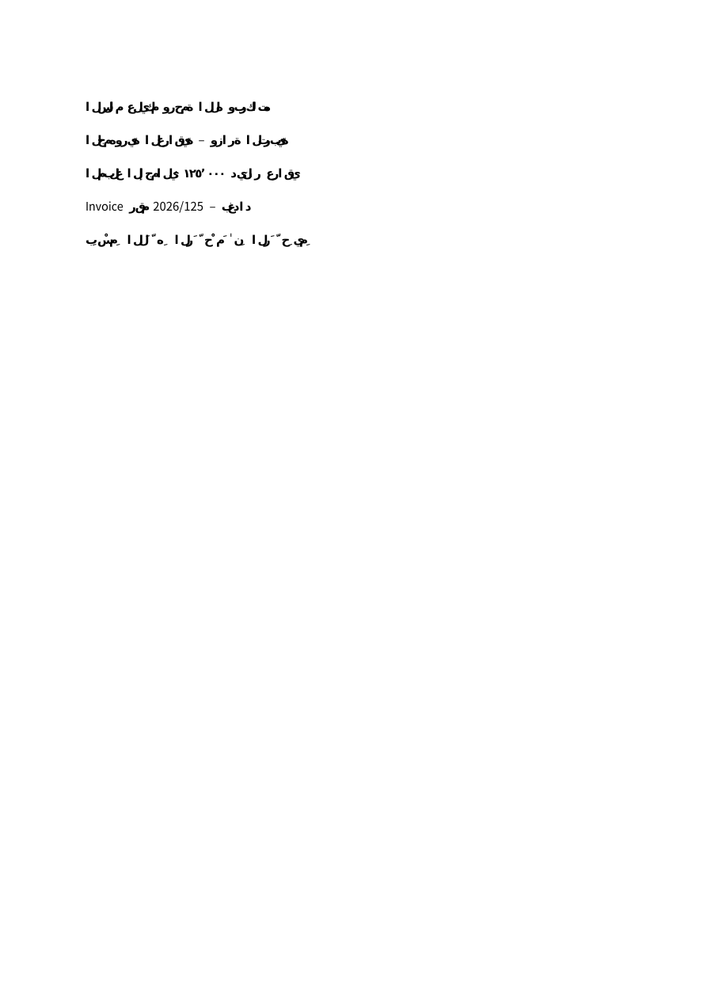
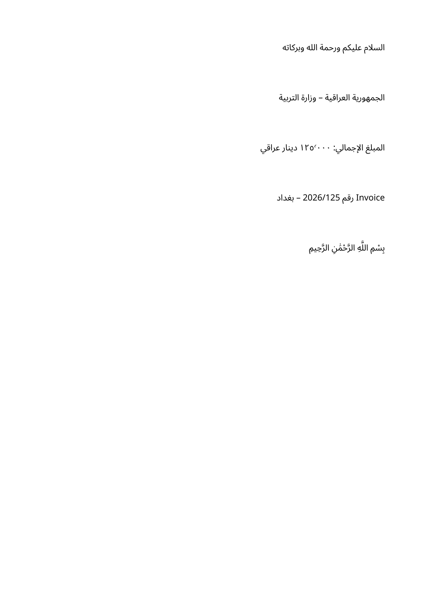

# العربية في PDF — التشخيص والإصلاح والتحقق

## السبب

في rhwp 0.8.7، مسار تشكيل الأسطر الأفقي مخصص أساساً للكورية القديمة، ويرفض مقاطع RTL صراحةً (`horizontal_ltr_bidi0` وشرط مستوى BiDi). اختيار خط يغطي Unicode في RhwpFonts يحل الحروف المفقودة فقط؛ لا يجري OpenType shaping أو ترتيب Unicode. إضافة Noto إلى `--font-path` لم تصلح الملف المعاد إنتاجه. كذلك كان مسار SVG يحول النص إلى مسارات، وقارئ PDF يرتب الكلمات من اليسار إلى اليمين هندسياً، فيفقد ترتيب العربية.

## التنفيذ

- `ArabicTextLayout`: خوارزميات Unicode #9/#14/#29 وHarfBuzz، تشكيل مع سياق الكلمة، التفاف عند حدود grapheme، خطوط Noto ثابتة مضمنة في التجميع، وخط احتياطي للمحارف الأخرى. اتجاه المحتوى مستقل عن لغة الواجهة.
- `ArabicDocumentPdf`: يستعمل نموذج HDocument الموجود، ويختار المسار العربي للمستندات التي تحتوي العربية، مع الحفاظ على المسار السابق لغيرها. فقرات وهوامش وصفحات ورؤوس وتذييلات وجداول وصور ومربعات نص وأشكال. يحترم اتجاه DOCX/HTML/PPTX الصريح والمحاذاة الصريحة.
- `ArabicPdfGlyphWriter`: مجموعات خطوط PDF Type 3 حقيقية، تضم أشكال glyphs من الخط بعد HarfBuzz، وToUnicode لكل scalar أصلي. الحركات مرتبطة بخط الأساس؛ السطر المختلط يستخدم مجموعة واحدة عندما تسمح أحجامه وألوانه. لا تحويل للصفحات إلى صور، ولا طبقة نص مخفية، ولا نص منسوخ في metadata.
- العلامة المؤقتة داخل الملف الوسيط تُستبدل كلها، ويُزال مورد خطها قبل تسليم الناتج. فشل الاستبدال يوقف التحويل.
- `PdfDocumentReader`: يقرأ Unicode الحقيقي ويستعيد ترتيب محارف المجموعات من رموز الخط وعمليات PDF؛ يدعم ActualText ويعالج اتجاه ملفات PDF الأخرى هندسياً عند غياب البنية المنطقية.
- `SvgTextSource`: يحتفظ بالنص المنطقي الأصلي لعناصر SVG البسيطة، قبل تقسيمها المرئي. النصوص ذات مسارات أو توزيع أحرف خاص تستمر في مسار الرسومات السابق.
- لا استبدال لمحركات خارجية غير موثوقة، ولا تغييرات لمسارات الوسائط والأرشيف.

## الاختبارات

`ArabicPdfTests` يولّد TXT/Markdown/HTML/DOCX/XLSX/PPTX/HWPX بأسماء عربية ويختبر PDF→TXT. قارئ PDFium مستقل يتحقق من البحث والنسخ للعينات الخمس، بما فيها العبارة المشكّلة كاملة والتاريخ `2026/125`. يوجد اختبار SVG بسيط، وفقرات طويلة وجدول 25 صفاً مع الدمج والتقسيم والضغط. المقارنة البصرية تستعمل ثلاث صور مرجعية ولّدها Pillow/libraqm خارج Filee بالخط الثابت نفسه. ملف LibreOffice أصلي مستقل يتحقق من ثبات البكسلات وUnicode بعد عمليات PDF.

كل تشغيل CI يحفظ ملفات المصدر الاصطناعية وPDF والصور والنصوص، إضافة إلى صور الواجهة العربية السابقة. النشر مشروط بنجاح هذه الاختبارات على الأنظمة الخمسة، وباختبار EXE/ZIP وDEB وDMG الفعلية. الاختبارات المتخطاة تُدرج منفصلة ولا تُحسب ناجحة.

## التثبيت والتحديثات

التنزيل: https://github.com/86msa/Filee/releases

- Windows x64: شغّل Setup.exe أو فك Portable.zip؛ احذف التثبيت من إعدادات Windows.
- Ubuntu 22.04/24.04 وDebian ذي الاعتماديات المتوافقة: `sudo apt install ./Filee-1.12.1-arabic.2-linux-x64.deb` (استبدل arm64 عند الحاجة). الإزالة: `sudo apt remove filee`؛ تبقى إعدادات المستخدم ومستنداته.
- Linux tar.gz: فك الحزمة وشغّل `./install.sh` دون sudo وفق INSTALL.txt.
- macOS: افتح DMG واسحب Filee.app إلى Applications ثم أخرج القرص. النسخة غير موثقة وقد تمنع الحماية تشغيلها؛ لا يوجد تجاوز للحماية. راجع INSTALL.txt للإزالة والتنظيف.
- استخدم `sha256sum --check SHA256SUMS.txt` على Linux، أو `shasum -a 256` على macOS، أو `Get-FileHash -Algorithm SHA256` على Windows.
- تحديثات هذا الإصدار التجريبي يدوية من صفحة fork؛ بيانات المستودع وروابط التحديث لا تستهدف KnifeLemon/Filee.

## الحدود

راجع [ملاحظات الإصدار](ARABIC-RELEASE.md). دمج الخلايا رأسياً والأعمدة والقوالب المكتبية المعقدة لا تحمل ضمان تطابق طباعي؛ فهذه القيود مرتبطة بنموذج المصدر ومحرك التخطيط. لا يوجد OCR، ولا ضمان PDF/A من دون أداة تحقق مستقلة. توقيع Apple/Notarization وWindows Authenticode يحتاج بيانات اعتماد غير متاحة في هذه المهمة. RPM غير منشورة لعدم اختبار توزيعة مستهدفة.

## الصور

| قبل الإصلاح (rhwp) | بعد الإصلاح (نص قابل للبحث) |
|---|---|
|  |  |

## تحقق البيئة المحلية

نجح `dotnet build Filee.slnx -c Release` دون أخطاء (تسعة تحذيرات سابقة)، وشُغّل `dotnet format`. اختبارات PDF العربية: **14 ناجحاً، صفر فشل أو تخطٍ**، بما فيها نسخ العينات الخمس في PDFium والمقارنة البصرية المستقلة.

تشغيل الحل المحلي الكامل: **1699 ناجحاً، 18 متخطى، 4 فاشلة**. الفاشلة هي اختبار تصدير صفحة PDF إلى SVG في LibreOffice 26.8 alpha المقدم بالبيئة، عرض أعمدة XLS في النسخة نفسها (15.8945 بدلاً من 14)، ترميز AMR في FFmpeg النظامي، واختبار عرض النسخ لمحركي Ghostscript/LibreOffice النظاميين ذوي بيانات إصدار غير متاحة. هذه ليست نتائج ناجحة. النسخة المحملة من FFmpeg 9 تدعم AMR لكنها تفتقد Speex، بينما نسخة النظام تدعم Speex وتفتقد AMR؛ لم يُضعف أي اختبار لتجاهل ذلك. الحزم لا تضم هذين المحركين الاختياريين؛ نتائج CI للحزم الفعلية وعمليات التثبيت هي بوابة النشر. اختبارات IPC الخاصة بالتشغيل المفرد اجتازت بعد السماح لمسار .NET النظامي بإنشاء mutex.
